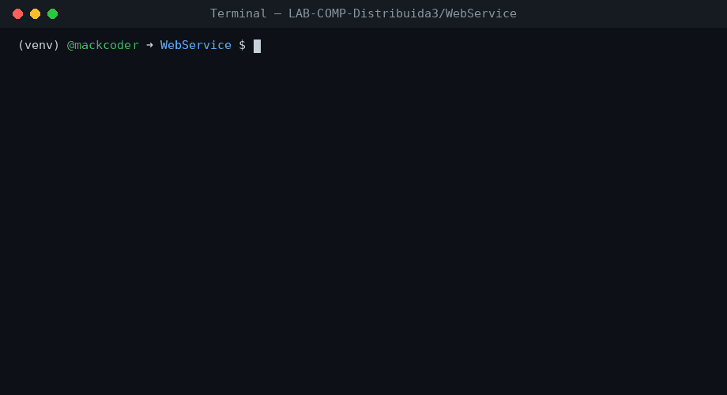
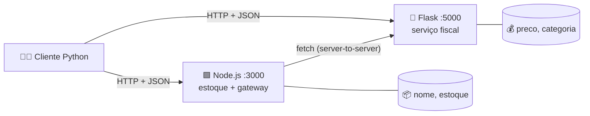
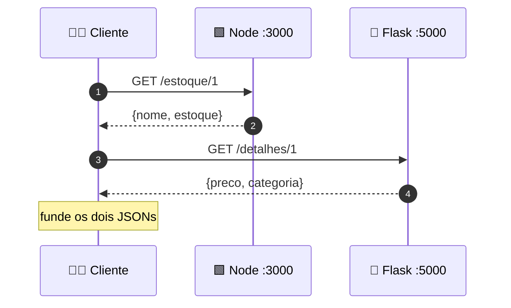
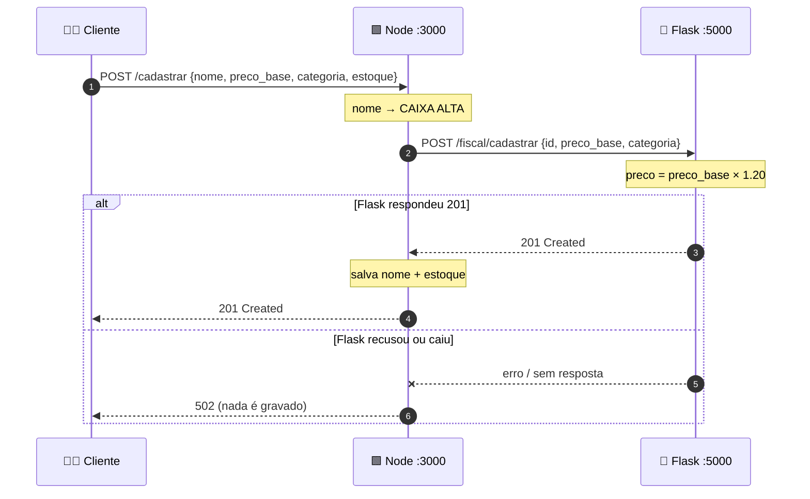

<div align="center">


<br/>

<!-- Status do repositório -->
<a href="https://github.com/mackcoder/LAB-COMP-Distribuida3/stargazers"></a>
<a href="https://github.com/mackcoder/LAB-COMP-Distribuida3/watchers"></a>
<a href="https://github.com/mackcoder/LAB-COMP-Distribuida3/network/members"></a>


<br/>


<br/><br/>


<br/><br/>

**🎓 Laboratório de Web Services · Computação Distribuída · Profs. Alcides e Mário**

Dois serviços REST independentes, um em **🐍 Python (Flask)** e outro em **🟩 Node.js (Express)**,<br/>
que conversam entre si e com clientes Python **apenas por HTTP + JSON**.

[🏗️ Arquitetura](#arquitetura) •
[🔌 Endpoints](#endpoints) •
[🧪 Exercícios](#exercicios) •
[🚀 Como executar](#como-executar) •
[✅ Testes](#testes) •
[🧠 Conceitos](#conceitos)

</div>

<p align="center">
  
</p>

---

<a id="arquitetura"></a>

## 🏗️ Arquitetura

<p align="center">
  
</p>

> 💡 Cada serviço é **dono de uma parte dos dados**: nenhum deles tem sozinho a informação completa de um produto.

| | Serviço | Porta | Arquivo | Responsabilidade | Dados |
|:---:|---|:---:|---|---|---|
| 🐍 | **Flask** | `5000` | `aula-flask/app.py` | Serviço **fiscal** | `preco`, `categoria`, cálculo de imposto |
| 🟩 | **Node.js** | `3000` | `aula-node/server.js` | Serviço de **estoque** e porta de entrada | `nome`, `estoque`, proxy para o Flask |



> ⚠️ Os dados ficam **em memória** (dicionários/objetos): reiniciar um servidor volta ao estado inicial.

---

## 📁 Estrutura

```text
WebService/
├── 🐍 aula-flask/
│   └── app.py                # Flask: serviço fiscal (porta 5000)
├── 🟩 aula-node/
│   ├── index.js              # exemplo da aula (porta 3000)
│   ├── server.js             # Node: serviço de estoque + exercícios (porta 3000)
│   └── package.json
├── 📄 cliente.py             # exemplo da aula: consome os dois /api/data
├── 📊 cliente_relatorio.py   # Ex. 1 (relatório integrado) e Ex. 3 (monitor de status)
└── ✅ teste-deliver.py       # testes da entrega, sem pytest
```

---

<a id="endpoints"></a>

## 🔌 Endpoints

| Método | Rota | Serviço | Ex. | Descrição |
|:---:|---|:---:|:---:|---|
|  | `/api/data` | 🐍 🟩 | Aula | Mensagem de exemplo |
|  | `/detalhes/<id>` | 🐍 | 1, 2 | Preço e categoria do produto |
|  | `/estoque/:id` | 🟩 | 1, 5 | Nome e quantidade em estoque |
|  | `/api/full-info/:id` | 🟩 | 2 | **Proxy:** o Node consulta o Flask e devolve tudo junto |
|  | `/status` | 🐍 🟩 | 3 | Contrato idêntico: `{service, status, timestamp}` |
|  | `/cadastrar` | 🟩 | 4A | Recebe o produto completo e distribui |
|  | `/fiscal/cadastrar` | 🐍 | 4B | Aplica 20% de imposto e salva |

**Códigos HTTP usados:**


---

<a id="exercicios"></a>

## 🧪 Exercícios

<details open>
<summary><b>1️⃣ Ex. 1 · Cliente integrador</b> <i>(integração no cliente)</i></summary>

<br/>

`cliente_relatorio.py` pede um ID, faz **um GET em cada servidor** e **funde** os dois JSONs. A integração acontece **no cliente**.



```text
Digite o ID do produto: 1
ID: 1 | Nome: Dell XPS 13 | Preço: R$ 2500.0 | Estoque: 10
```

</details>

<details open>
<summary><b>2️⃣ Ex. 2 · Comunicação server-to-server (proxy)</b> <i>(integração no servidor)</i></summary>

<br/>

<p align="center">
  
</p>

Em `GET /api/full-info/:id`, o **Node age como cliente do Flask** (`fetch`) e devolve o objeto completo. O cliente final só conhece o Node, e o Flask fica "escondido" atrás dele (padrão **API Gateway**). A integração acontece **no servidor**.

```json
GET http://localhost:3000/api/full-info/1
{"id":"1","nome":"Dell XPS 13","estoque":10,"categoria":"Laptops","preco":2500}
```

| | 1️⃣ Integração no cliente | 2️⃣ Integração no servidor |
|---|---|---|
| Quem chama os dois serviços | o cliente | o Node |
| O cliente conhece o Flask? | ✅ sim | ❌ não |
| Requisições do cliente | 2 | 1 |

</details>

<details open>
<summary><b>3️⃣ Ex. 3 · Padronização de contrato</b></summary>

<br/>

Os dois serviços expõem `GET /status` com **a mesma estrutura**, inclusive o formato do timestamp:

```json
{"service": "flask-fiscal", "status": "online", "timestamp": "2026-11-04T11:54:41.663Z"}
```

> 📜 A função `verificar_status(urls)` monitora qualquer lista de URLs **sem nenhum `if` por linguagem**: ela depende só do contrato.

</details>

<details open>
<summary><b>4️⃣ Ex. 4 · Cadastro com persistência distribuída</b></summary>

<br/>

<p align="center">
  
</p>

1. 🔠 O Node recebe o produto e converte o nome para **CAIXA ALTA**.
2. 📤 Envia ao Flask **só** os dados fiscais (`id`, `preco_base`, `categoria`).
3. 💰 O Flask aplica **+20%** (200.0 → **240.0**), salva em `produtos_tecnicos` e responde **201**.
4. 💾 **Só depois do 201** o Node salva `nome` e `estoque` em `produtos_comerciais`.



> 🛡️ Se o Flask recusar ou estiver fora do ar, o Node **não grava nada**, o que evita dados inconsistentes entre os serviços.

</details>

<details open>
<summary><b>5️⃣ Ex. 5 · Protocolo de erro e validação</b></summary>

<br/>

<p align="center">
  
</p>

Os dois servidores validam o ID **antes** de processar. Um ID negativo ou não numérico interrompe a requisição com **400** e o mesmo corpo nos dois lados:

```json
GET http://localhost:3000/estoque/-5   →  400
{"error": "INVALID_ID", "message": "O ID deve ser um inteiro positivo"}
```

</details>

---

<a id="como-executar"></a>

## 🚀 Como executar

### 📋 Pré-requisitos

```bash
sudo apt update
sudo apt install python3 python3-pip python3-venv nodejs npm -y
```

> ⚠️ O Node precisa ser **18 ou mais novo** (o `fetch` nativo é usado no proxy). Confira com `node -v`.

<table>
<tr>
<th>🐍 Terminal 1 · Flask</th>
<th>🟩 Terminal 2 · Node</th>
<th>🧑‍💻 Terminal 3 · Cliente e testes</th>
</tr>
<tr>
<td>

```bash
cd WebService/aula-flask
python3 -m venv venv
source venv/bin/activate
pip install Flask requests
python3 app.py
```

</td>
<td>

```bash
cd WebService/aula-node
npm install
node server.js
```

</td>
<td>

```bash
cd WebService
source aula-flask/venv/bin/activate
python3 cliente_relatorio.py
python3 teste-deliver.py
```

</td>
</tr>
</table>

### 🌍 No navegador (Codespaces)

Na aba **Ports**, abra a URL da porta `3000` ou `5000` e acrescente a rota no fim, por exemplo:

```text
https://<seu-codespace>-3000.app.github.dev/api/full-info/1
```

---

<a id="testes"></a>

## ✅ Testes da entrega

`teste-deliver.py` usa só `assert`, **sem pytest**, com **uma função por item** do enunciado:

| | Função | Verifica |
|:---:|---|---|
| ✅ | `exemplos_aula` | `/api/data` dos dois servidores |
| ✅ | `teste_preparacao_bases` | Bases iniciais `produtos_fiscais` e `produtos_estoque` |
| ✅ | `teste_ex1_cliente_integrador` | Linha do relatório idêntica à do enunciado |
| ✅ | `teste_ex2_proxy` | `/api/full-info/1` traz `nome` **e** `preco` |
| ✅ | `teste_ex3_status_padronizado` | Chaves `service`, `status` e `timestamp` nos dois `/status` |
| ✅ | `teste_ex4_cadastro_distribuido` | Node guarda `TECLADO` e Flask guarda o preço `240.0` |
| ✅ | `teste_ex5_validacao_id` | `-5` e `abc` retornam 400 com o JSON de erro padrão |

<div align="center">

### 🏆 Resultado: **7/7 testes aprovados**


</div>

---

<a id="conceitos"></a>

## 🧠 Conceitos praticados

| | Conceito | Onde aparece |
|:---:|---|---|
| 🌐 | **REST:** recursos identificados por URI e métodos HTTP com significado (`GET` lê, `POST` cria) | todos os endpoints |
| 🔁 | **Stateless:** cada requisição carrega tudo o que precisa | todos os endpoints |
| 🤝 | **Interoperabilidade:** Python e JavaScript se comunicam só por HTTP + JSON | Ex. 1, 2, 4 |
| 🔀 | **Integração no cliente × no servidor** | Ex. 1 × Ex. 2 |
| 📜 | **Contratos de API:** formato de status e de erro iguais, independentes da linguagem | Ex. 3, 5 |
| 🧩 | **Responsabilidade por serviço e consistência distribuída** | Ex. 4 |

---

## 🛠️ Tecnologias

<div align="center">


**Python 3 · Flask · requests · Node.js · Express · GitHub Codespaces**

</div>

---

<div align="center">

Feito com ☕ por **[Naoto Ushizaki](https://github.com/mackcoder)** · Computação Distribuída

⭐ Se este laboratório te ajudou, deixe uma estrela!


</div>
